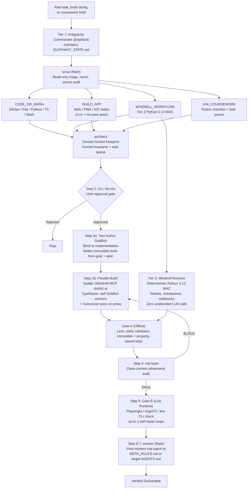

# `/fleet`

A deterministic, self-improving 7-agent harness that turns a 1-3 sentence idea, brain dump, or coursework brief into a verified deliverable across GitOps and infrastructure, Windmill automations, standalone web or PWA apps, university coursework, and general codebases.

Paste a task in any repository that has this harness's `AGENTS.md` and the Commander routes it automatically, no extra prompting required.

## Features

**Orchestration**
- Elephant-Goldfish model: Commander holds persistent state in `ELEPHANT_STATE.md` across multi-step missions while Goldfish workers run isolated, atomic units with zero carry-over context
- 7 specialized subagents (`@scout`, `@architect`, `@ui-ux`, `@ios-pwa`, `@builder`, `@red-team`, `@evolver`) plus scoped `TypeName: "self"` Goldfish for multi-unit parallel execution
- Zero-prompting auto-routing: any raw brain dump or task pasted into a wired repository is an implicit `/fleet` mission
- 4-domain routing: `CODE_OR_INFRA`, `WINDMILL_WORKFLOW`, `BUILD_APP`, and university coursework, each with domain-locked blueprints and verification contracts

**Verification and safety**
- Independent blind test authoring: a separate Test Author Goldfish receives only the goal and `@architect` spec to write unit, edge-case, and property-based invariant tests before implementation; implementers are forbidden from editing or weakening those tests
- Gate A: offline linting, formal invariants, and property-based tests (`hypothesis`, `fast-check`, `jqwik`, `proptest`) before anything hits live infra
- Gate B: live end-to-end path verification with up to 3 self-repair iterations; runs do not stop at `git push`
- 3-gate Windmill QA: `ruff check .`, `wmill lint`, and live MCP `test_run_*` plus `get_run` log inspection
- Draft-first mutations: live infrastructure writes, GitOps pushes, SSH targets, and external state changes pause for diff and explicit approval
- `@red-team` runs in a clean context with zero prior assumptions, issuing `PASS`, `CONDITIONAL PASS`, or `BLOCK`

**UI and web**
- Locked `Manpage Paper & Ink` design system (`STYLE_BIBLE.md`) with OKLCH tokens, type scale, density grid, and hairline borders
- `playwright-audit.mjs` with `--pwa`, `--geo`, `--interactions`, and `--expect-sw` flags
- Public vs. private GEO: `PUBLIC` sites require Schema.org JSON-LD, semantic landmarks, and `/llms.txt`; `PRIVATE` tools enforce `noindex, nofollow`
- iOS Safari and standalone PWA guardrails: `100dvh`, `>=16px` inputs, safe-area insets, manifest validation

**Prose and academic**
- Native humanizer pass on all user-facing docs, UI microcopy, slides, speaker scripts, PR descriptions, and commit messages
- University coursework mode: bland student formatting on first pass, real `2x` HiDPI desktop screenshots, zero synthetic GUI compositing
- `@evolver` routes lessons from repair loops and red-team blocks into permanent rule patches in `META_RULES.md` or the target repo's `AGENTS.md`

**Token efficiency**
- Context7 and Serena MCP integrations for versioned docs and LSP symbol lookups in large repos
- `modern-web-guidance` on demand for Baseline native HTML/CSS/JS patterns and legacy audits
- Windmill Tier 2 defaults to Workflows as Code with zero unattended LLM calls

## Architecture



### Tier 1 (Elephant Orchestrator and Goldfish Workers)

Antigravity runs `/fleet` (`.agents/skills/fleet/SKILL.md`) as the Elephant, maintaining `ELEPHANT_STATE.md` across multi-step missions and keeping its own context clean, while delegating to 7 specialized subagents and scoped `TypeName: "self"` Goldfish workers:

- `@scout` (`flash`): read-only triage, one-shot repo recon, and secret-key audit
- `@architect`: domain-locked blueprints, parity inventories, formal invariants, and `ELEPHANT_STATE.md` task queues
- `@ui-ux`: `STYLE_BIBLE.md` layout shells, 5-state matrices, and WCAG AA specs for `BUILD_APP`
- `@ios-pwa`: iOS Safari and standalone PWA safe-area insets, `100dvh`, `>=16px` input sizing, manifest and service worker specs
- `@builder` (and scoped `self` Goldfish): Windmill MCP draft builder for `WINDMILL_WORKFLOW`; isolated Goldfish workers for multi-unit code, forensics, LaTeX, or presentation builds
- `@red-team`: clean-context adversarial auditor (`PASS`, `CONDITIONAL PASS`, or `BLOCK`)
- `@evolver` (`flash`): post-mortem rule patcher routing harness lessons to `META_RULES.md` and repo lessons to `<target-repo>/AGENTS.md`

### Tier 2 (Deterministic Runtime, When Warranted)

Self-hosted [Windmill](https://www.windmill.dev/) runs Python 3.13 Workflows as Code (`@workflow` and `@task`) with zero unattended LLM calls by default. Pure code, university coursework, GitOps, and standalone apps stay in their native toolchains.

## Quickstart

1. Clone and symlink globally:
   ```bash
   git clone <repo-url> ~/windmill-factory
   ln -s ~/windmill-factory/.agents/agents ~/.gemini/agents
   ln -s ~/windmill-factory/.agents/skills/fleet ~/.gemini/config/skills/fleet
   ln -s ~/windmill-factory/.agents/skills/humanizer ~/.gemini/config/skills/humanizer
   ```
2. Optional — auto-route any target repository into `/fleet`:
   Copy a drop-in starter file from `templates/repo-agents/` into the target repo root:
   ```bash
   cp ~/windmill-factory/templates/repo-agents/AGENTS.uni.md /path/to/uni-module/AGENTS.md
   cp ~/windmill-factory/templates/repo-agents/AGENTS.app.md /path/to/my-app/AGENTS.md
   cp ~/windmill-factory/templates/repo-agents/AGENTS.infra.md /path/to/infra-repo/AGENTS.md
   ```
3. Optional Windmill Tier 2 setup:
   - Set your remote URL and workspace (defaults to `factory`) in `wmill.yaml`.
   - Connect the Windmill MCP server with `scopes: ["mcp:all", "mcp:session"]`.
   - Create `f/meta/notify` in your workspace if you use mobile approval or status pings.
4. Optional token-saving and web platform tooling:
   - Connect [`upstash/context7`](https://github.com/upstash/context7) for versioned library docs and [`oraios/serena`](https://github.com/oraios/serena) for symbol lookups in large repos.
   - `BUILD_APP` tasks use [`GoogleChrome/modern-web-guidance`](https://github.com/GoogleChrome/modern-web-guidance) (`npx -y modern-web-guidance@latest`) for Baseline-native HTML, CSS, and JS patterns and legacy-scan audits.
5. Paste a raw task, coursework brief, or brain dump in any wired repository, or invoke `/fleet <goal>`. Add `--auto` on a single `READ_ONLY` task to skip the Step 2 Go/No-Go pause.

## Repository map

| Path | Purpose |
|---|---|
| `AGENTS.md` | Always-loaded router (~3.4 KB) |
| `META_RULES.md` | Global guardrails: Windmill WAC, verification, anti-slop, academic rules |
| `STYLE_BIBLE.md` | Locked v1 `Manpage Paper & Ink` design system |
| `.agents/skills/fleet/SKILL.md` | 7-step Elephant-Goldfish Commander state machine |
| `.agents/skills/humanizer/SKILL.md` | Prose anti-slop pass for docs, slides, UI copy, PRs, and commits |
| `.agents/agents/*.md` | 7 subagent definitions |
| `templates/repo-agents/` | Drop-in `AGENTS.uni.md`, `AGENTS.app.md`, and `AGENTS.infra.md` starters |
| `templates/ui-kit/` | `tokens.css`, `BLOCKS.md`, `playwright-audit.mjs` (`--pwa`, `--geo`, `--interactions`) |
| `templates/infra-kit/` | `gate-a-k8s.sh` offline manifest validator |

## License

MIT
